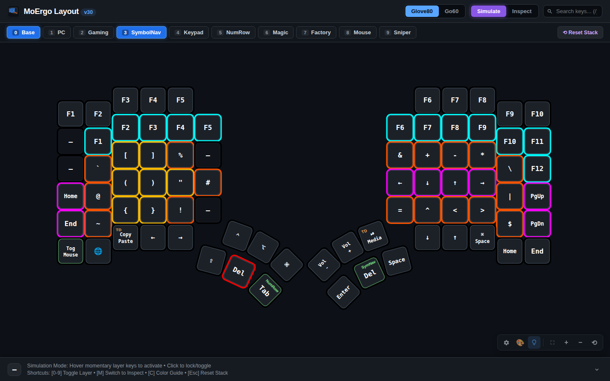
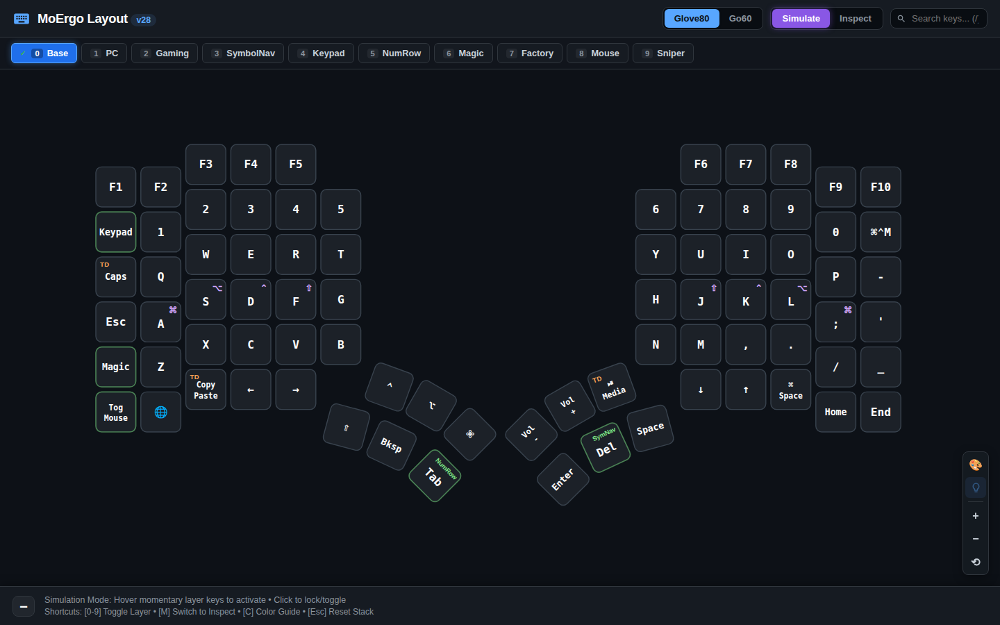
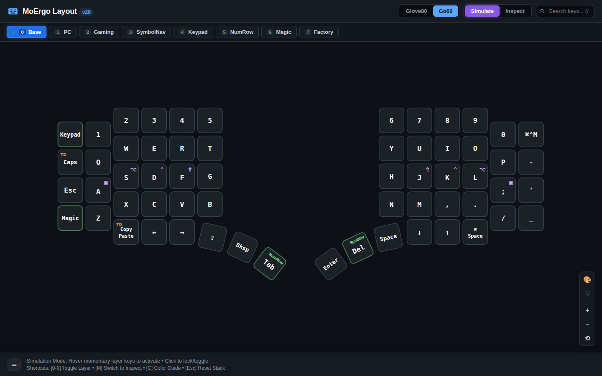
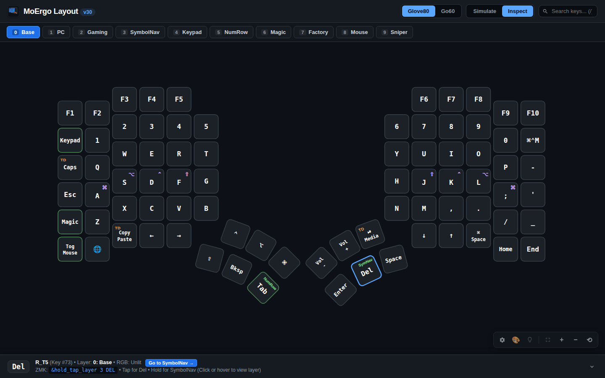
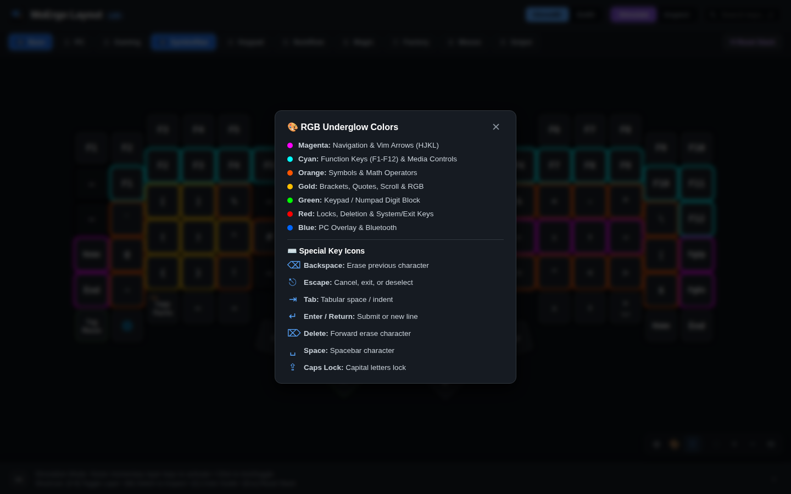
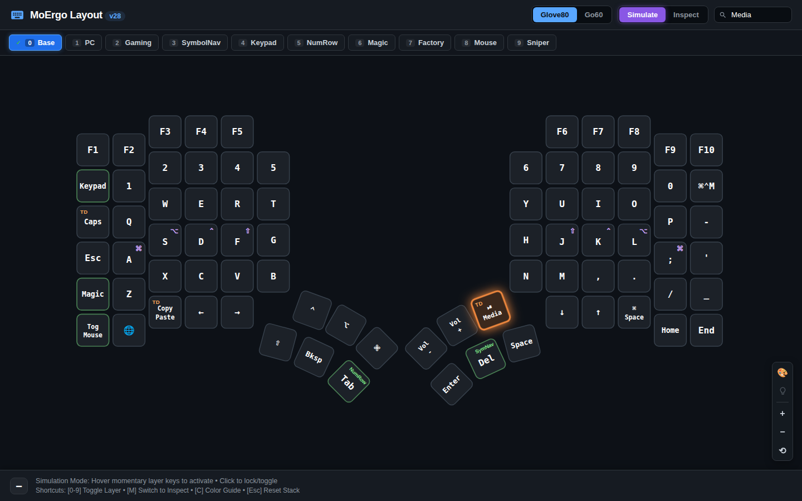

# MoErgo Layout Visualizer

Interactive web-based layout viewer and firmware simulator for the **MoErgo Glove80** and **MoErgo Go60** keyboards.



---

## Major Features

### 1. Simulation Mode (Default)
- **Composite Layer Stack:** Simulates the real-time active ZMK layer hierarchy. Overlays active layers on top of `Base` and accurately resolves pass-through (`&trans` / `▽`) keys down to their source layer.
- **Layer Toggling on Click / Tap:** Clicking or tapping any layer key (dedicated `&tog`, `&mo`, or hold-tap `&hold_tap_layer` / `&lt` like `Del/SymbolNav` and `Tab/NumRow`) toggles that layer on/off in the active stack. Works seamlessly on both desktop and mobile touch devices.
- **Momentary Hover Preview:** On desktop, hovering the mouse cursor over a layer key temporarily previews that layer. Moving the cursor away reverts back to the active stack, while clicking locks/toggles the layer.
- **Stack Reset:** Easily reset back to the Base layer via the `⟲ Reset Stack` button in the layer tab bar or by pressing `Esc`.



*Glove80 full 80-key contoured layout in Simulation Mode showing home-row mod indicators (`⌘`, `⌥`, `⌃`, `⇧`), tap dance badges (`TD`), and dual-function thumb cluster keys.*



*Go60 60-key compact split layout simulation with streamlined thumb clusters and identical layer hierarchy.*

### 2. Inspect Mode
- Direct layer-by-layer inspection of raw ZMK keycodes, behaviors (`&kp`, `&hml`, `&hmr`, `&lt`, `&hold_tap_layer`), tap dances, and parameters.
- Clickable layer-link badges jump directly to the target layer.
- Back button and `Esc` key navigation history.



*Inspect Mode displaying detailed key information for `Del / SymbolNav` (Key #73), including raw ZMK binding `&hold_tap_layer 3 DEL`, target layer jump badge, and full tooltip explanation.*

### 3. Per-Key RGB Underglow & Fade Simulation
- Visualizes exact per-key RGB colors defined in `underglow-layer` blocks from `*.keymap`.
- In Simulation Mode, switching or toggling layers illuminates modified keys and gracefully fades out after **1 second**, matching the hardware underglow experience.
- Interactive **🎨 Colors** modal providing a quick reference legend for the color coding system (Cyan F-keys, Magenta navigation, Orange symbols, Green numpad, Red locks/deletions, Blue PC/Bluetooth, etc.).


*Composite Layer Simulation showing active `SymbolNav` layer with Cyan function row, Gold/Orange symbols, and Magenta navigation cluster.*



*Built-in RGB Underglow color reference modal providing quick color coding descriptions.*

### 4. URL Filter Persistence
- Keyboard model (`?kb=glove80` | `?kb=go60`), view mode (`?mode=simulate` | `?mode=inspect`), active layer (`?layer=3`), and inspection targets (`?inspect=73`) are persisted in the URL query string.
- Page refreshes and browser Back/Forward buttons maintain the current view without resetting filters.

### 5. Dynamic Build System & Custom Behavior Annotations
- The build script ([`scripts/build_viewer.py`](../scripts/build_viewer.py)) dynamically extracts key definitions from MoErgo Layout Editor JSON and ZMK keymaps.
- **Doc-Comment Annotations:** Custom behaviors in `custom_defined_behaviors` can be annotated with `/* @viewer: Line1 | Line2 | @badge: TD | @tooltip: ... */` to customize keycap presentation without modifying Python scripts.
- **Auto-Derivation:** Custom tap dances without explicit comments automatically derive multi-step labels and tooltips directly from their ZMK `bindings = <...>` definitions.

### 6. Mobile Landscape & Focus Mode (Zen Mode)
- **Compact Landscape View:** Automatically compacts the header (30px), prevents layer tab wrapping, and collapses the key inspector into a single-line status bar (24px) when viewed in landscape on smartphones and small viewports.
- **Scroll-to-Collapse Address Bar:** On mobile touch devices, document scrolling is enabled so swiping upward smoothly scrolls the top logo bar out of view, triggers mobile browser auto-hiding of the native address/navigation bar, and docks the layer tabs to the top edge (`position: sticky`).
- **Focus / Fullscreen Mode (`[F]` or `⛶`):** Toggles Zen mode, hiding all header/footer chrome and requesting native hardware fullscreen on supported devices. The keyboard layout expands to fill over 90% of the screen.
- **Collapsible Inspector (`[I]` or `▼`/`▲`):** Toggle the key inspector drawer between full detail mode, compact single-line mode, or collapsed.
- **Horizontal & Minimizable Canvas Tools (`[T]` or `⚙️`):** The floating tools (Legend, RGB, Fullscreen, Zoom) are laid out horizontally at the bottom right with idle translucency (opacity 0.65). A gear toggle collapses the entire toolstrip into a single 26×26px button so the rightmost keys (`F9`, `F10`, `Home`, `End`) are never obstructed.

### 7. Search & Keyboard Shortcuts
- Key search (`/` shortcut): Highlights matching keys across the keyboard layout.
- Fast keyboard shortcuts: `[0-9]` toggle layers, `[M]` toggle mode, `[G]` Glove80, `[O]` Go60, `[C]` Color legend, `[F]` Focus/Fullscreen mode, `[I]` Toggle inspector drawer, `[T]` Toggle canvas tools, `[Esc]` reset stack or exit Focus mode.



*Searching for "Media" highlights the custom multi-tap media control key on the right thumb cluster.*

---

## Directory Structure

```
viewer/
├── src/                  # Modular viewer source files
│   ├── index.html        # Clean HTML template
│   ├── style.css         # Responsive styling & themes
│   └── app.js            # Interactive layer simulator and event logic
├── data.json             # Generated JSON dataset containing parsed keys & RGB
├── index.html            # Compiled standalone HTML with inlined assets (local VPS)
├── serve.py              # Lightweight HTTP server on port 8088
├── coords_glove80.json   # Physical key coordinates for Glove80 (80 keys)
└── coords_go60.json      # Physical key coordinates for Go60 (60 keys)
```

---

## Building the Viewer

Whenever layout files or behaviors change, rebuild the viewer:

```bash
python3 scripts/build_viewer.py
```

This compiles `viewer/src/` into standalone self-contained HTML files:
- `viewer/index.html`: Used by the local HTTP server (`viewer/serve.py 8088`).
- `docs/index.html`: Used for static web hosting.

## Running the Local Server

```bash
python3 viewer/serve.py 8088
```

Accessible locally or over VPN/Tailscale at `http://<IP>:8088/`.

## Generating Feature Screenshots

To automatically regenerate all high-resolution feature screenshots demoed above:

```bash
python3 scripts/capture_screenshots.py
```
